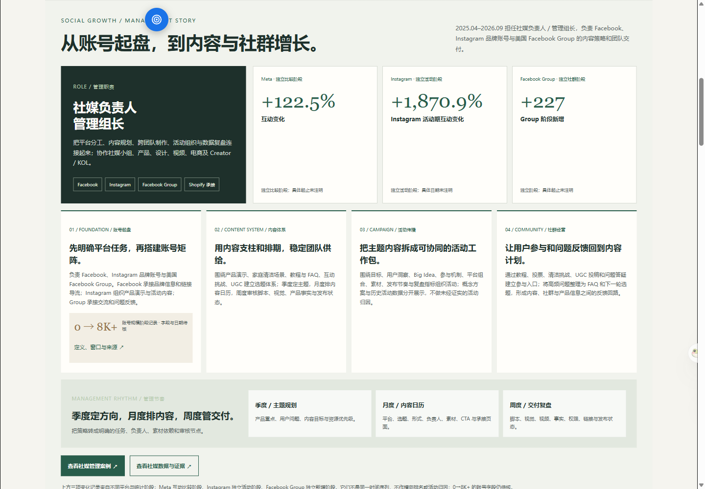
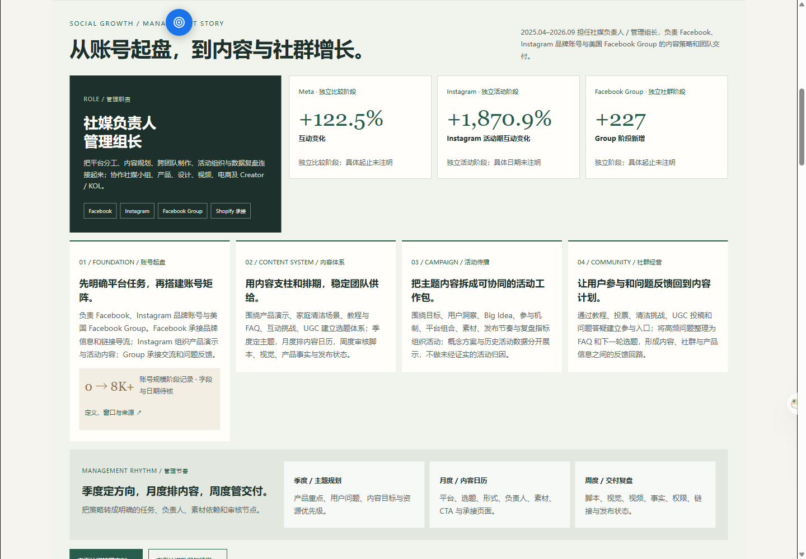
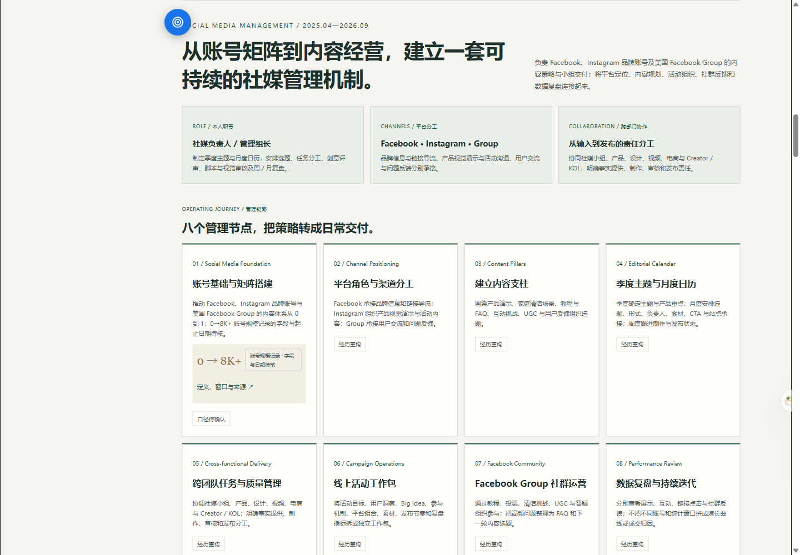
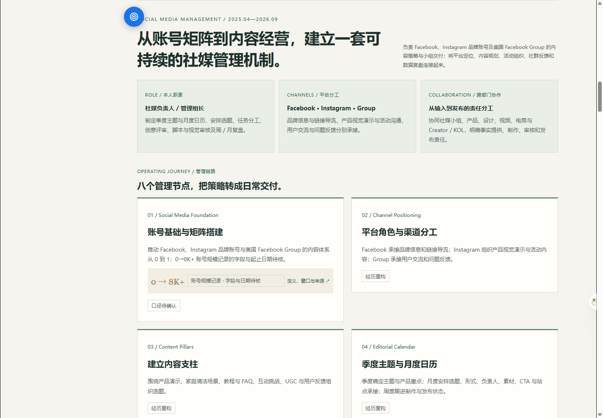
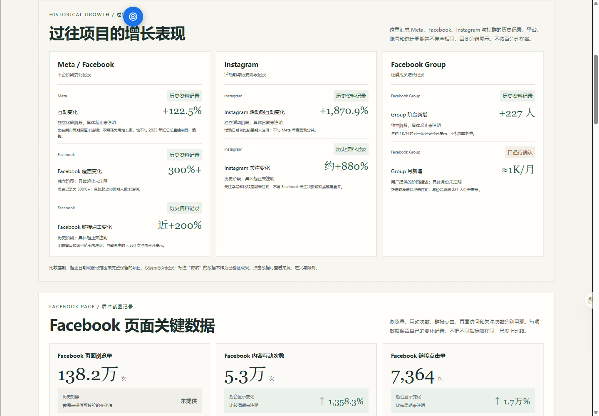
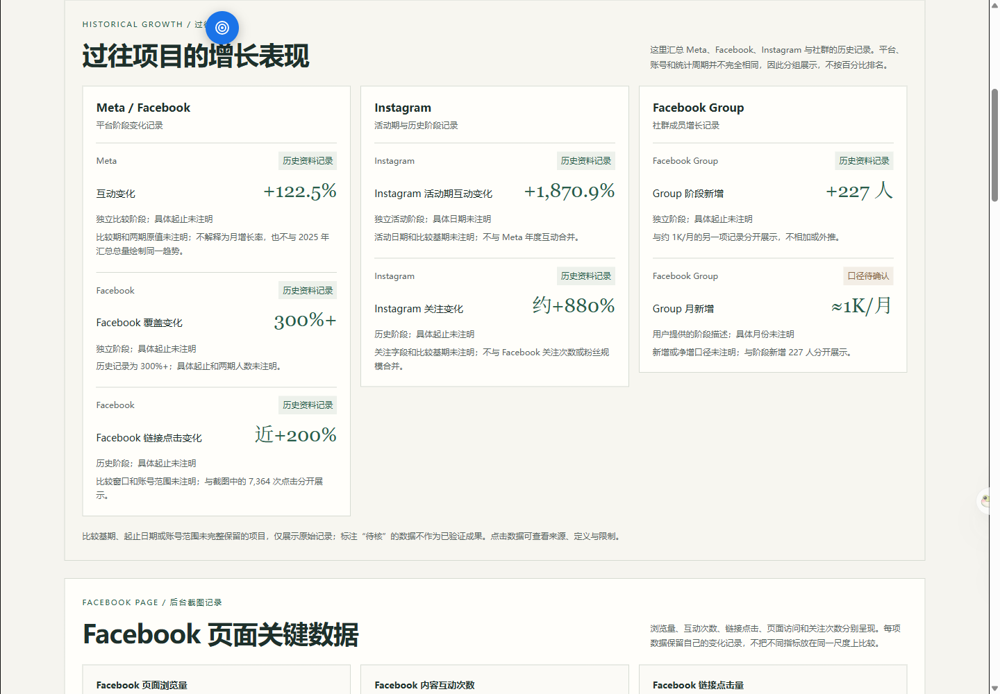

# 四档视口修复前后对比

所有图片为同一页面、同一模块位置的浏览器实拍；点击图片可查看原尺寸。

## 1440px

### 首页增长故事

| 修复前 | 修复后 |
| --- | --- |
|  |  |

### 社媒管理案例

| 修复前 | 修复后 |
| --- | --- |
|  |  |

### 社媒数据

| 修复前 | 修复后 |
| --- | --- |
|  |  |

## 390px

### 首页增长故事

| 修复前 | 修复后 |
| --- | --- |
|  |  |

### 社媒管理案例

| 修复前 | 修复后 |
| --- | --- |
|  |  |

### 社媒数据

| 修复前 | 修复后 |
| --- | --- |
|  |  |

## 375px

### 首页增长故事

| 修复前 | 修复后 |
| --- | --- |
|  |  |

### 社媒管理案例

| 修复前 | 修复后 |
| --- | --- |
|  |  |

### 社媒数据

| 修复前 | 修复后 |
| --- | --- |
|  |  |

## 360px

### 首页增长故事

| 修复前 | 修复后 |
| --- | --- |
|  |  |

### 社媒管理案例

| 修复前 | 修复后 |
| --- | --- |
|  |  |

### 社媒数据

| 修复前 | 修复后 |
| --- | --- |
|  |  |
