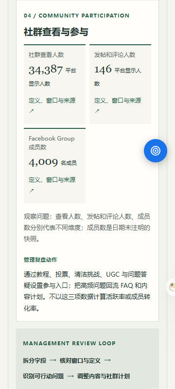
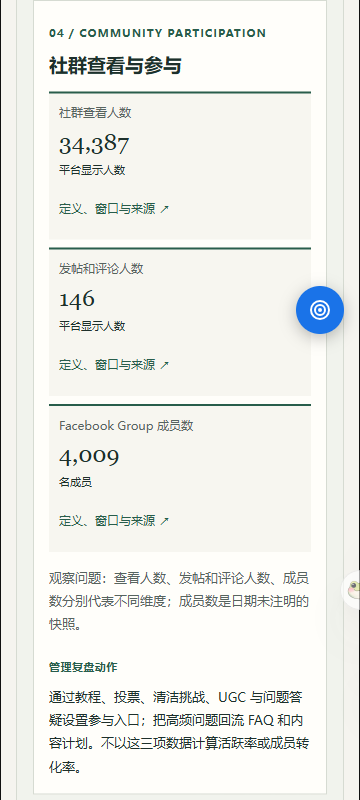

# PR11 实拍截图索引

本轮切换视口并重载后捕获，元数据见 screenshot-manifest.json。

## 1440px

[首页首屏](desktop-1440.png) · [管理决策](after/1440-decision.png) · [Group 证据](after/1440-group.png) · [原图证据页](after/1440-data.png)

## 390px

[首页首屏](mobile-390.png) · [管理决策](after/390-decision.png) · [Group 证据](after/390-group.png) · [原图证据页](after/390-data.png)

## 375px

[首页首屏](mobile-375.png) · [管理决策](after/375-decision.png) · [Group 证据](after/375-group.png) · [原图证据页](after/375-data.png)

## 360px

[首页首屏](mobile-360.png) · [管理决策](after/360-decision.png) · [Group 证据](after/360-group.png) · [原图证据页](after/360-data.png)

## P2 修复前后

| 360px 修复前 | 360px 修复后 |
|---|---|
|  |  |

[原生点击抽屉](interaction-evidence/360-group-drawer.png)
